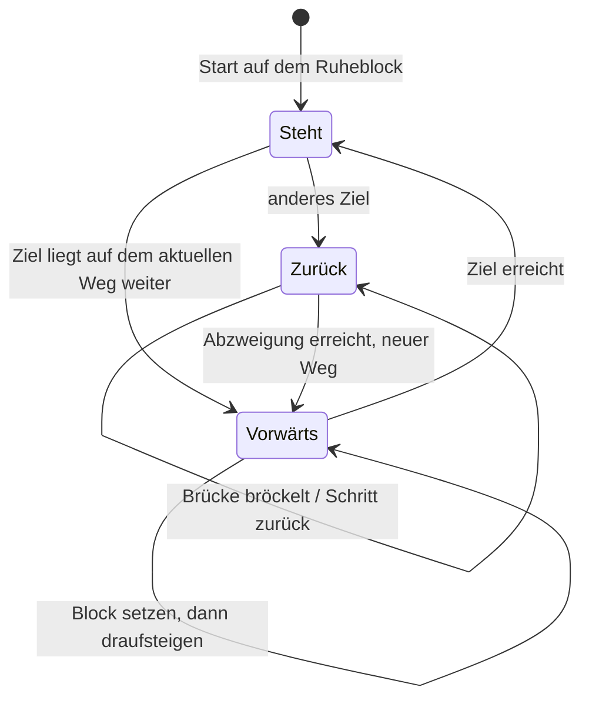

# Spec: Figur auf der Insel

Die Insel ist die Navigation der Seite. Eine Figur zeigt, wo man gerade ist, und läuft über Brücken dorthin, wohin man zeigt. Diese Spec beschreibt das Verhalten; umgesetzt ist es als reine Zustandsmaschine in [`src/scripts/island-state.ts`](../../src/scripts/island-state.ts), geprüft von [`island-state.test.ts`](../../src/scripts/island-state.test.ts). Die Geometrie (Felder, Wege, Plätze) kommt aus [`src/data/island-layout.ts`](../../src/data/island-layout.ts), geprüft von [`island-layout.test.ts`](../../src/data/island-layout.test.ts).

## Begriffe

| Begriff | Bedeutung |
| --- | --- |
| **Ziel** | Ein Block, zu dem die Figur laufen kann: `about`, `workshops`, `videos`, `blog`, der Pilz-Ausgang `mitwachsen`, eine Kiste wie `workshops/event_storming` oder `blog/mitwachsen` (Kiste einer Blog-Serie) oder das Easter Egg `tree`. |
| **Weg** | Folge von Feldern von der Inselmitte zu einem Ziel. Jedes Feld ist ein vorhandener Block oder ein Brückenblock (wird gesetzt). |
| **Baum der Wege** | Der Weg einer Kiste beginnt mit dem kompletten Weg ihres Bereichs (Insel → Bereich → Kiste). Gleiche Felder teilen sich einen Brückenblock. |
| **Ruheblock** (`rest`) | Ziel der angezeigten Seite. Dort steht die Figur, wenn sie nirgendwo anders hin will. Im Blog bestimmt ihn `restFor()` (`src/data/blog.ts`): Posts einer Serie mit Kiste und die Serienseite ruhen auf der Kiste der Serie (`blog/<serie>`), die Übersicht und alle anderen Posts auf dem Regal (`blog`). |
| **Gezeigter Block** (`hover`) | Block unter Maus oder Tastaturfokus. |
| **Abzweigung** | Ende des gemeinsamen Anfangs zweier Wege. Bis dorthin muss die Figur nie zurück. |
| **Link nach außen** (`outside`) | Block, dessen Link auf eine fremde Domain führt: der Pilz-Ausgang `mitwachsen` auf www.mitwachsen-spiele.de. Er lädt im selben Tab, sofort beim Klick; das Etikett trägt ↗ (für Screenreader versteckt), dazu nur für Screenreader „– eigene Seite: mitwachsen-spiele.de“. Die Figur läuft nur beim Zeigen hin; er ist **nie Ruheblock**. |

## Ereignisse

| Ereignis | Auslöser | Wirkung |
| --- | --- | --- |
| `aim(id)` | Hover oder Tastatur-Fokus (`:focus-visible`) auf einen Block, auch auf den Blog | `hover = id` |
| `leave(id)` | Maus weg, Fokus verlassen | `hover = null`, falls `id` der gezeigte Block war |
| `select(id)` | Seitenwechsel (nach `astro:after-swap`) | `id` wird Ruheblock, Hüpf-Animation. Unbekannte Ziele (auch fremde Adressen), Links nach außen und der aktuelle Ruheblock ändern nichts: Zwischen zwei Teilen derselben Serie bleibt die Figur auf der Kiste stehen und hüpft nicht |
| `returned` | Zurück aus dem Cache des Browsers (`pageshow` mit `persisted`), z. B. nach einem Link nach außen | wie `leave` für den gezeigten Block: `hover = null`, die Figur geht zum Ruheblock. Ohne gezeigten Block ändert sich nichts |
| `step` | Takt alle 130 ms, solange die Figur nicht zur Ruhe gekommen ist | ein Schritt nach den Regeln unten |

*Tests: „ignoriert select auf den aktuellen oder einen unbekannten Block …“, „steht bei jedem Teil einer Serie auf deren Kiste …“, „ignoriert das Verlassen eines Blocks, auf den nicht mehr gezeigt wird …“, „macht den Pilz-Ausgang nie zum Ruheblock …“, „geht nach Zurück aus dem Cache …“; im Browser: „Insel: Tastaturfokus schickt die Figur auch zum Blog“*

## Wohin die Figur will

`target = hover ?? rest`. Hat der Ruheblock keinen Weg (unbekannter Block), bleibt die Figur in der Inselmitte. *Test: „bleibt bei einem unbekannten Ruheblock in der Inselmitte …“*

## Regeln für einen Takt

1. **Vorwärts.** Ist das Ziel der aktuelle Weg: Liegt vor ihr ein Brückenfeld, das noch nicht steht, setzt sie es (ein Takt); sonst tritt sie darauf (ein Takt) und schaut in Laufrichtung. Sie betritt nie ein Brückenfeld, das nicht steht. Das gilt auch am Blog: Früher fiel sie dort ins Leere, heute baut sie zwei Brückenblöcke zum Regal und bleibt stehen. *Tests: „lässt beim Rückweg die Brücken bröckeln und setzt auf dem Hinweg jeden Block …“, „baut die Brücke zum Blog und bleibt am Regal stehen …“*
2. **Zurück bis zur Abzweigung.** Ist das Ziel ein anderer Weg: Steht vor ihr noch ein eigener Brückenblock, bröckelt er (3 Takte sichtbar). Sonst geht sie einen Schritt zurück, bis sie an der Abzweigung zum neuen Weg ist. Dort wechselt sie auf den neuen Weg; gemeinsame Brücken bleiben stehen. *Tests: „geht von Kiste zu Kiste nur bis zum Bereichs-Block zurück …“, „lässt gemeinsame Brückenblöcke stehen …“*
3. **Ziel wechseln geht jederzeit.** Ändert sich das Ziel mitten auf dem Weg, gilt ab dem nächsten Takt Regel 1 oder 2. *Test: „wechselt mitten auf dem Weg das Ziel …“*
4. **Zur Ruhe kommen.** Hat sie das Ziel erreicht und bröckelt nichts mehr, endet der Takt. *Test: „kommt aus jeder Kombination von Ruheblock und Ziel zur Ruhe“*

## Was angezeigt wird

| Was | Regel |
| --- | --- |
| Position | Fuß auf dem zuletzt betretenen Feld, vor dem ersten Schritt die Inselmitte |
| Brücken | Brückenfelder des aktuellen Weges, die stehen; bröckelnde sind kurz noch sichtbar. Inselblöcke, die davor stehen, verdecken sie (Vordergrund-Ebene in Tiefenreihenfolge) |
| Kisten eines Bereichs | sichtbar, solange der Bereich (oder eine seiner Kisten) Ruheblock ist oder die Figur noch auf den Brücken des Bereichs unterwegs ist |
| Wippen | Blöcke, über die die Figur gerade geht oder auf denen sie steht, wippen nicht |
| Markierung | Ruheblock und sein Bereich sind markiert. Der Ruheblock-Link trägt `aria-current`: `page`, wenn sein Link die angezeigte Seite ist, sonst `true` (ein Post steht auf der Kiste seiner Serie, deren Link zur Serienseite führt). *Browser-Test: „Insel: Das Regal führt zum Blog, die Kiste dahinter zur Serie …“* |
| Sprechblase | Dekoration, für Screenreader ausgeblendet (`aria-hidden`). Sichtbar nur, wenn die Figur auf ihrem Ruheblock steht und nirgendwo anders hin will. Auf Bereichen spricht sie zum Bereich, beim ersten Aufruf der Startseite begrüßt sie („Hi! Zeig auf einen Block.“), auf Kisten schweigt sie. Am Regal sagt sie: „Früher bin ich hier runtergefallen.“ Oben im Baum: „Schöne Aussicht!“ |

*Tests: „steht beim Start auf dem Block der Seite …“, „läuft nach select zum neuen Ruheblock, öffnet dessen Bereich …“, „spricht nach einer Auswahl zum Bereich …“, „baut die Brücke zum Blog und bleibt am Regal stehen …“, „steht bei jedem Teil einer Serie auf deren Kiste …“, „klettert beim Baum …“*

## Invarianten der Geometrie

Geprüft in `island-layout.test.ts` für die volle Belegung aller Kisten-Plätze:

- Jeder Schritt geht auf ein benachbartes Feld: ein Feld seitlich und höchstens eine Stufe hoch oder runter – oder senkrecht auf einen gerade gestapelten Block (Baum).
- Der Weg jeder Kiste beginnt mit dem kompletten Weg ihres Bereichs.
- Jeder Brückenblock existiert nur einmal, auch wenn sich Wege ein Feld teilen.
- Kein Zielblock überlappt einen anderen oder die Insel.
- Mehr Einträge als Plätze brechen den Build mit einer Meldung ab, die sagt, was zu tun ist. Am Blog gibt es einen Platz: eine Kiste pro Serie mit `featured: true` und mindestens einem veröffentlichten Teil, nie eine pro Post.
- Der Blog ist ein Link auf `/blog/` mit zwei Brückenblöcken; jeder Block hat einen Link. Die Kiste einer Serie steht hinter dem Regal. Brücke und Kiste vergrößern den Ausschnitt der Szene nicht.
- Eine Seite mit einem unbekannten Block als `rest` bricht den Build ab (`Island.astro`), zum Beispiel ein Post auf der Kiste einer Serie ohne Kiste.
- Das Ergebnis ist deterministisch.
- Der Pilz-Ausgang ist der einzige Link nach außen, mit Fliegenpilz-Block und ohne Kisten. Eine Seite mit einem Link nach außen als `rest` bricht den Build ab (`Island.astro`).

## Außerhalb dieser Spec

- **Blick zum Cursor** (Kopf drehen und nicken, Körper umdrehen) ist reine Darstellung in der Web Component (`larmic-island.ts`) und ändert nur die Blickrichtung, nie den Weg. Die Kopfgeometrie prüft `head.test.ts`.
- **Freudenhüpfer:** Fährt die Maus über den Namen im Kopf, hüpft die Figur zweimal. Nur wenn sie steht (kein Takt), nur mit Maus und ohne reduzierte Bewegung. Reine Darstellung in der Web Component, ändert weder Weg noch Zustand.
- **Handy:** Unter 700 px Containerbreite stehen die Blöcke als Reihen unter der Insel, Brücken sind ausgeblendet, die Figur bleibt in der Inselmitte. Die Zustandsmaschine läuft dort nicht Takt für Takt, sondern springt mit `settle` sofort in den Endzustand (gleiches Ergebnis; *Test: „kommt in der schmalen Ansicht mit settle …“*).
- **Reduzierte Bewegung** (`prefers-reduced-motion`): Zeigen auf einen Block schickt die Figur nicht los; nach einem Seitenwechsel steht sie mit `settle` sofort am Ziel.
- **Ohne JavaScript** zeigt die Seite das Startbild: Figur auf dem Ruheblock, Brücken dorthin, alle Blöcke sind normale Links, auch der Blog und die Kiste der Serie. *Browser-Tests: „Inhalte bleiben lesbar, die Insel besteht aus normalen Links“, „Blogpost: Die Figur steht auf der Kiste der Serie …“*
