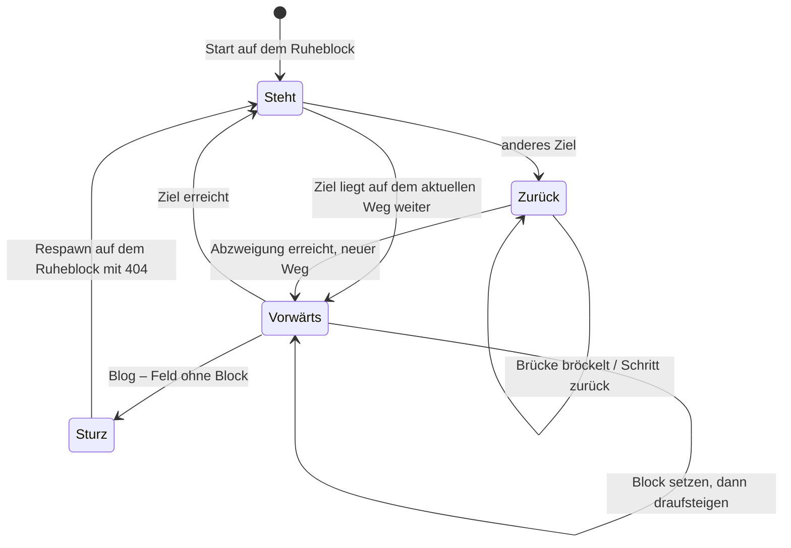

# Spec: Figur auf der Insel

Die Insel ist die Navigation der Seite. Eine Figur zeigt, wo man gerade ist, und läuft über Brücken dorthin, wohin man zeigt. Diese Spec beschreibt das Verhalten; umgesetzt ist es als reine Zustandsmaschine in [`src/scripts/island-state.ts`](../../src/scripts/island-state.ts), geprüft von [`island-state.test.ts`](../../src/scripts/island-state.test.ts). Die Geometrie (Felder, Wege, Plätze) kommt aus [`src/data/island-layout.ts`](../../src/data/island-layout.ts), geprüft von [`island-layout.test.ts`](../../src/data/island-layout.test.ts).

## Begriffe

| Begriff | Bedeutung |
| --- | --- |
| **Ziel** | Ein Block, zu dem die Figur laufen kann: `about`, `workshops`, `videos`, `blog`, eine Kiste wie `workshops/event_storming` oder das Easter Egg `tree`. |
| **Weg** | Folge von Feldern von der Inselmitte zu einem Ziel. Jedes Feld ist ein vorhandener Block, ein Brückenblock (wird gesetzt) oder beim Blog das Feld, auf dem sie ins Leere tritt. |
| **Baum der Wege** | Der Weg einer Kiste beginnt mit dem kompletten Weg ihres Bereichs (Insel → Bereich → Kiste). Gleiche Felder teilen sich einen Brückenblock. |
| **Ruheblock** (`rest`) | Ziel der angezeigten Seite. Dort steht die Figur, wenn sie nirgendwo anders hin will. |
| **Gezeigter Block** (`hover`) | Block unter Maus oder Tastaturfokus. |
| **Abzweigung** | Ende des gemeinsamen Anfangs zweier Wege. Bis dorthin muss die Figur nie zurück. |

## Ereignisse

| Ereignis | Auslöser | Wirkung |
| --- | --- | --- |
| `aim(id)` | Hover oder Tastatur-Fokus (`:focus-visible`) auf einen Block – beim Blog nur Hover, Klick oder Enter | `hover = id`, Blog-Sperre aufheben, 404-Meldung löschen (außer bei `blog`) |
| `leave(id)` | Maus weg, Fokus verlassen | `hover = null`, falls `id` der gezeigte Block war |
| `select(id)` | Seitenwechsel (nach `astro:after-swap`) | `id` wird Ruheblock, 404-Meldung löschen, Hüpf-Animation. Unbekannte Ziele und der aktuelle Ruheblock ändern nichts |
| `step` | Takt alle 130 ms, solange die Figur nicht zur Ruhe gekommen ist | ein Schritt nach den Regeln unten |

## Wohin die Figur will

`target = hover ?? rest` – außer der gezeigte Block ist der Blog und sie ist gerade dort gestürzt; dann will sie zum Ruheblock.

## Regeln für einen Takt

1. **Sturz läuft durch.** Steht die Figur auf einem Sturz-Feld, fällt sie 7 Takte lang und erscheint dann auf ihrem Ruheblock (alle Brücken dorthin stehen sofort). Zeigt man noch auf den Blog oder nirgendwohin, erscheint die 404-Meldung; der Blog ist gesperrt, bis man auf einen anderen Block zeigt. *Test: „stürzt am Blog …“*
2. **Vorwärts.** Ist das Ziel der aktuelle Weg: Liegt vor ihr ein Brücken- oder Sturz-Feld, das noch nicht steht, setzt sie es (ein Takt); sonst tritt sie darauf (ein Takt) und schaut in Laufrichtung. Sie betritt nie ein Brückenfeld, das nicht steht. *Test: „lässt beim Rückweg die Brücken bröckeln und setzt auf dem Hinweg jeden Block …“*
3. **Zurück bis zur Abzweigung.** Ist das Ziel ein anderer Weg: Steht vor ihr noch ein eigener Brückenblock, bröckelt er (3 Takte sichtbar). Sonst geht sie einen Schritt zurück, bis sie an der Abzweigung zum neuen Weg ist. Dort wechselt sie auf den neuen Weg; gemeinsame Brücken bleiben stehen. *Tests: „geht von Kiste zu Kiste nur bis zum Bereichs-Block zurück …“, „lässt gemeinsame Brückenblöcke stehen …“*
4. **Ziel wechseln geht jederzeit.** Ändert sich das Ziel mitten auf dem Weg, gilt ab dem nächsten Takt Regel 2 oder 3. *Test: „wechselt mitten auf dem Weg das Ziel …“*
5. **Zur Ruhe kommen.** Hat sie das Ziel erreicht, ist kein Sturz im Gange und bröckelt nichts mehr, endet der Takt. *Test: „kommt aus jeder Kombination von Ruheblock und Ziel zur Ruhe“*

## Was angezeigt wird

| Was | Regel |
| --- | --- |
| Position | Fuß auf dem zuletzt betretenen Feld, vor dem ersten Schritt die Inselmitte |
| Brücken | Brückenfelder des aktuellen Weges, die stehen; bröckelnde sind kurz noch sichtbar. Inselblöcke, die davor stehen, verdecken sie (Vordergrund-Ebene in Tiefenreihenfolge) |
| Kisten eines Bereichs | sichtbar, solange der Bereich (oder eine seiner Kisten) Ruheblock ist oder die Figur noch auf den Brücken des Bereichs unterwegs ist |
| Wippen | Blöcke, über die die Figur gerade geht oder auf denen sie steht, wippen nicht |
| Markierung | Ruheblock und sein Bereich sind markiert, der Ruheblock-Link trägt `aria-current="page"` |
| Sprechblase | Dekoration, für Screenreader ausgeblendet (`aria-hidden`); dass es den Blog nicht gibt, steht im Namen des Blog-Buttons. Sichtbar nur, wenn die Figur auf ihrem Ruheblock steht und nirgendwo anders hin will. Auf Bereichen spricht sie zum Bereich, beim ersten Aufruf der Startseite begrüßt sie („Hi! Zeig auf einen Block.“), auf Kisten schweigt sie. Die 404-Meldung erscheint überall und bleibt, bis man woanders hinzeigt. Oben im Baum: „Schöne Aussicht!“ |

*Tests: „steht beim Start auf dem Block der Seite …“, „läuft nach select zum neuen Ruheblock, öffnet dessen Bereich …“, „spricht nach einer Auswahl zum Bereich …“, „klettert beim Baum …“*

## Invarianten der Geometrie

Geprüft in `island-layout.test.ts` für die volle Belegung aller Kisten-Plätze:

- Jeder Schritt geht auf ein benachbartes Feld: ein Feld seitlich und höchstens eine Stufe hoch oder runter – oder senkrecht auf einen gerade gestapelten Block (Baum).
- Der Weg jeder Kiste beginnt mit dem kompletten Weg ihres Bereichs.
- Jeder Brückenblock existiert nur einmal, auch wenn sich Wege ein Feld teilen.
- Kein Zielblock überlappt einen anderen oder die Insel.
- Mehr Einträge als Plätze brechen den Build mit einer Meldung ab, die sagt, was zu tun ist.
- Das Ergebnis ist deterministisch.

## Außerhalb dieser Spec

- **Blick zum Cursor** (Kopf drehen und nicken, Körper umdrehen) ist reine Darstellung in der Web Component (`larmic-island.ts`) und ändert nur die Blickrichtung, nie den Weg. Die Kopfgeometrie prüft `head.test.ts`.
- **Handy:** Unter 700 px Containerbreite stehen die Blöcke als Reihen unter der Insel, Brücken sind ausgeblendet, die Figur bleibt in der Inselmitte. Die Zustandsmaschine läuft dort nicht Takt für Takt, sondern springt mit `settle` sofort in den Endzustand (gleiches Ergebnis; *Test: „kommt in der schmalen Ansicht mit settle …“*).
- **Reduzierte Bewegung** (`prefers-reduced-motion`): Zeigen auf einen Block schickt die Figur nicht los; nach einem Seitenwechsel steht sie mit `settle` sofort am Ziel. Ein Klick auf den Blog zeigt direkt die 404-Meldung.
- **Ohne JavaScript** zeigt die Seite das Startbild: Figur auf dem Ruheblock, Brücken dorthin, alle Blöcke sind normale Links.
