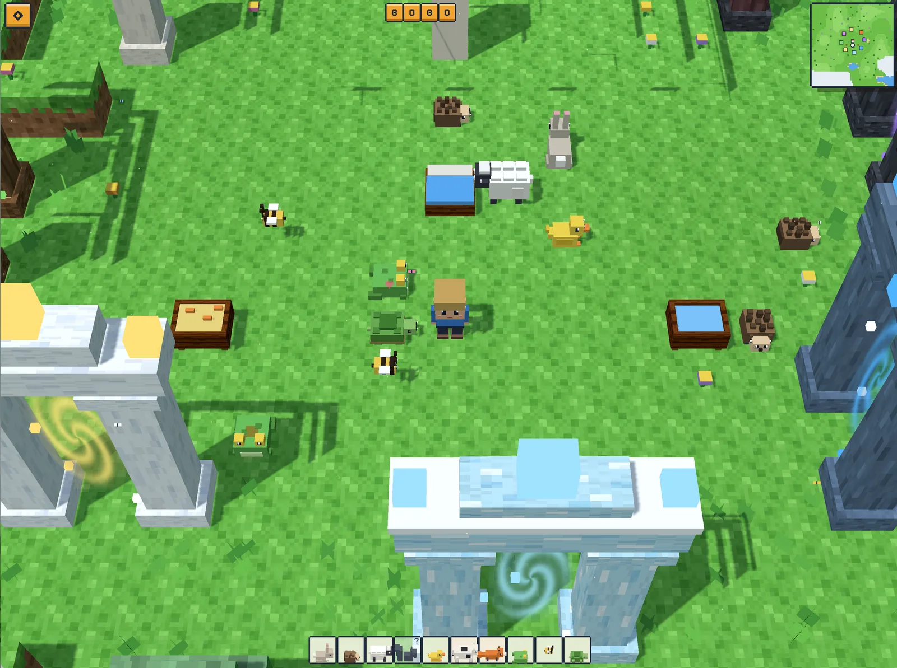

Mitwachsen habe ich für meinen Sohn gebaut. Ich wollte ihn behutsam an Spiele am Bildschirm heranführen und habe nichts gefunden, das mir dafür gefallen hat. Viele Kinderspiele leben von Werbung, verteilen ständig Sterne und Truhen und locken jeden Tag mit einer neuen Belohnung zurück. Das ist darauf ausgelegt, dass man nicht aufhört.

Ich wollte das Gegenteil: ein Spiel, in dem wir beide zusammen eine Welt entdecken. Er steuert, ich sitze daneben, und wir reden über das, was wir sehen. Einfach, langsam und so, dass das Aufhören leichtfällt.

## Was man im Spiel macht

* Mit der Figur über eine große Lichtung laufen und verlorene Tiere finden. Läuft man in ein Tier hinein, freut es sich und kommt mit.
* Die Tiere nach Hause auf die Wiese am Bett bringen. Dort bleiben sie, auch am nächsten Tag.
* Beeren pflücken, im Korb zum Futtertrog tragen und zusehen, wie sich alle freuen.
* Regen, Sonne und Regenbogen erleben. Wenn es regnet, stellen sich die Tiere unter den großen Pilz.
* Zum Schluss die Figur ins Bett bringen. Dann wird es Nacht, und das Spiel ist für heute vorbei.

## Worauf ich geachtet habe

* Keine Werbung, keine Käufe, keine Anmeldung.
* Keine Punkte und keine Belohnung fürs schnelle Drücken. Wer wild tippt, kommt nicht schneller voran.
* Kein Zeitdruck. Die Figur kann nichts falsch machen, und nichts geht verloren.
* Nichts, was zum Weiterspielen drängt: keine Tagesbelohnung, keine Erinnerungen, keine Kiste, die erst morgen aufgeht.
* Ein Ende, das zum Kind passt: Nach 15 bis 25 Minuten wird die Figur müde und möchte ins Bett. Gesperrt wird nichts, das entscheiden die Eltern.
* Der Spielstand bleibt im eigenen Browser. Es werden keine Daten verschickt.
* Beim ersten Start gibt es einen kurzen Hinweis für Eltern, was Kinderärzte zur Bildschirmzeit empfehlen.

## Warum „Mitwachsen“?

Das Spiel soll mit meinem Sohn größer werden. Jedes Jahr kommt etwas dazu, das zu seinem Alter passt. Im Moment gibt es die Version ab 3 Jahren: Gesteuert wird nur mit den Pfeiltasten, lesen muss niemand. Am Rand der Lichtung stehen schon große Tore zu weiteren Welten. Aufgehen werden sie später.
