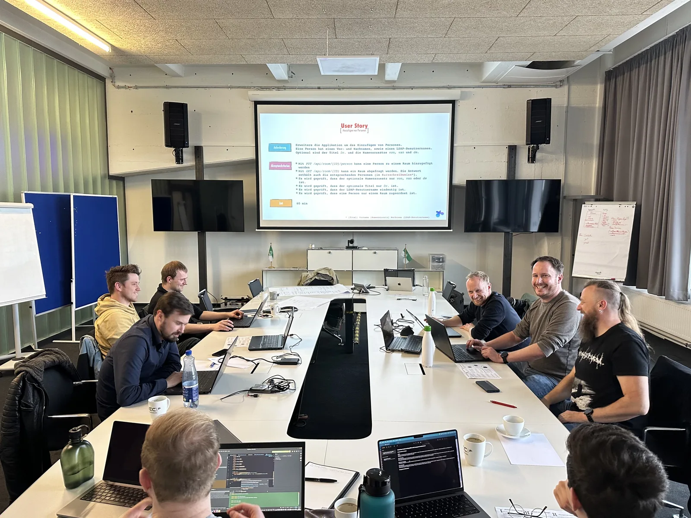

In vielen Projekten verschwindet die Fachlichkeit irgendwo zwischen Controller, Repository und Mapping-Code. Domain-Driven Design (DDD) holt sie zurück in den Mittelpunkt. Die hexagonale Architektur sorgt dafür, dass sie dort auch bleibt: Datenbank, Message Queue oder REST-Schnittstelle hängen außen dran und lassen sich austauschen, ohne dass der fachliche Kern etwas davon merkt.

Mit KI-gestützter Entwicklung wird das noch wichtiger. Wenn große Teile des Codes generiert werden, brauchst du klare Leitplanken dafür, was in den Kern gehört und was nicht.

## Was dich erwartet

* Zwei Tage, wenig Folien, viel Code
* Wir setzen gemeinsam User Stories in einer hexagonalen Architektur um
* Du arbeitest in deiner eigenen Programmiersprache
* Kleine Gruppe (max. 12), viel Raum für Fragen aus deinem Projektalltag

## Das bringst du mit

* Patterns, SOLID und Clean Code verspeist du zum Frühstück
* Du bist Software-Architekt:in oder willst es werden
* Du kannst dir 2 Tage am Stück freihalten
* Ein Entwickler-Notebook mit Git, IDE und der Programmiersprache deiner Wahl
