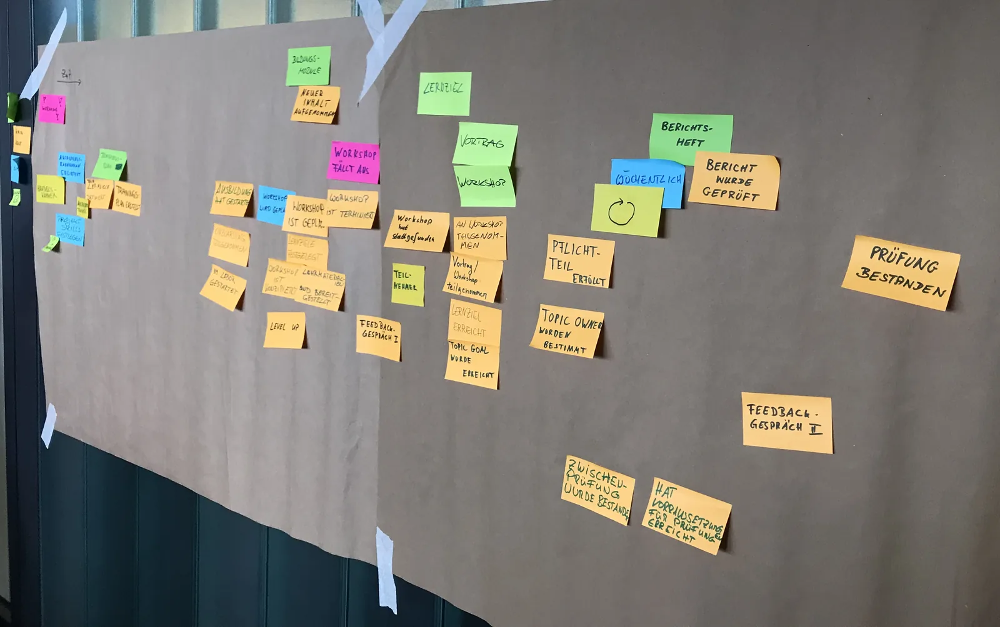

Event Storming ist eine Workshop-Methode, mit der ein Team einen Geschäftsprozess gemeinsam sichtbar macht. Statt Anforderungen in Dokumenten hin- und herzuschicken, stehen Entwicklung, Product Owner, Projektleitung und Fachbereich zusammen vor der Wand und sammeln, was im Prozess passiert: welche Ereignisse es gibt, was sie auslöst und wer beteiligt ist. Daraus entsteht Schritt für Schritt ein Bild, das alle verstehen.

Oft zeigen sich dabei auch die Stellen, an denen jemand sagt: „Moment, das läuft bei uns ganz anders.“ Genau diese Missverständnisse findet man hier, bevor sie im Code landen.

## Was dich erwartet

* 4 Stunden in Präsenz im Schuppen Eins
* Wir modellieren gemeinsam einen Beispielprozess, Schritt für Schritt
* Du nimmst mit, wann sich Event Storming lohnt und wie du es in dein Projekt bringst

## Für wen?

* Für alle, die an Software mitarbeiten: Entwicklung, Product Ownership, Projektleitung, Fachbereich
* Vorkenntnisse brauchst du keine
* Der Laptop kann zu bleiben, wir arbeiten mit Stift und Zetteln

Wer danach Lust auf mehr hat: Im Workshop zu [DDD und hexagonaler Architektur](/workshops/ddd_hexagonal_architecture_for_devs/) geht es darum, wie man Fachlichkeit sauber in Code bringt.
